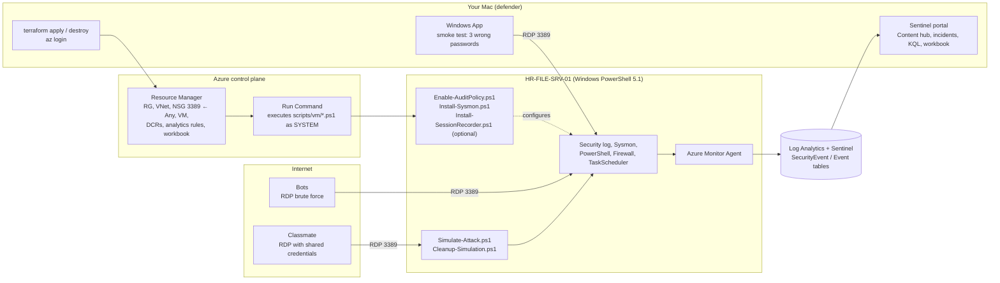

# Bait n' Switch — Windows RDP Honeypot + Microsoft Sentinel

Course project (Weeks 7–8): deploy a deliberately exposed Windows VM in Azure, collect telemetry
in Microsoft Sentinel, analyze real-world attacks from the internet and a simulated breach by a
classmate, and submit a PDF report.

> Everything here is scaffolding. The real data (IPs, countries, attempt counts, screenshots)
> only comes from your own workspace.

## Quick start (macOS, `az` and `terraform` already installed)

```bash
az login
```

```bash
cd infra/terraform && cp terraform.tfvars.example terraform.tfvars && terraform init && terraform apply
```

```bash
open "$(terraform output -raw rdp_url)"
```

PowerShell is not required locally: all `.ps1` scripts run on the Windows VM itself
(Windows PowerShell 5.1), delivered by Terraform via Azure Run Command.

See [`docs/GUIDE.md`](docs/GUIDE.md) for the phase-by-phase walkthrough.

## Who runs what



| Actor | Runs | Where |
|---|---|---|
| You | `terraform`, `az`, Windows App, Sentinel portal (KQL, incidents, workbook) | Mac / browser |
| Terraform → Azure | Creates all resources; Run Command delivers `scripts/vm/*.ps1` | Azure control plane |
| VM | Audit policy, Sysmon, session recorder; AMA ships logs to Sentinel | `HR-FILE-SRV-01` |
| Classmate | `Simulate-Attack.ps1` (or manual actions), then `Cleanup-Simulation.ps1` | RDP session on the VM |
| Bots | Brute-force RDP logons (4625) | Internet → port 3389 |

## Layout

| Path | Contents |
|---|---|
| [`docs/GUIDE.md`](docs/GUIDE.md) | Step-by-step guide for all 6 phases |
| [`infra/terraform/`](infra/terraform/) | Terraform: workspace + Sentinel, VM `HR-FILE-SRV-01` (`Standard_D2s_v6`), NSG 3389 ← Any, AMA, 2 DCRs, analytics rules, workbook, in-guest bootstrap |
| [`scripts/vm/Enable-AuditPolicy.ps1`](scripts/vm/Enable-AuditPolicy.ps1) | Enables required audit subcategories, command line in 4688, PowerShell script block logging |
| [`scripts/vm/Install-Sysmon.ps1`](scripts/vm/Install-Sysmon.ps1) | Sysmon with the SwiftOnSecurity config |
| [`scripts/vm/Install-SessionRecorder.ps1`](scripts/vm/Install-SessionRecorder.ps1) | RDP session screen recording (ffmpeg, starts at any user's logon) |
| [`scripts/classmate/Simulate-Attack.ps1`](scripts/classmate/Simulate-Attack.ps1) | "Suspicious" actions for the classmate, with a ground-truth log |
| [`scripts/classmate/Cleanup-Simulation.ps1`](scripts/classmate/Cleanup-Simulation.ps1) | Reverts everything Simulate-Attack did |
| [`kql/`](kql/) | KQL: smoke test, statistics, Geo-IP, attack timeline, Sysmon hunting |
| [`sentinel/honeypot-workbook.json`](sentinel/honeypot-workbook.json) | "Honeypot Dashboard" workbook: attack map, top usernames, trends |
| [`report/report-template.md`](report/report-template.md) | PDF report template (Phase 6) with a ready Hardening section |

## Checklist

- [ ] **Phase 1.** Workspace + Sentinel, VM, NSG 3389 ← Any, strong password, *Windows Security Events via AMA* connector (All Events)
- [ ] Audit policy and Sysmon are installed by Terraform (Run Command). Verify they work **before** the classmate attack
- [ ] Content hub → install "Windows Security Events" (do **not** create a second DCR in the connector wizard)
- [ ] **Phase 2.** 3 failed RDP logons from your machine show up in `kql/01-smoke-test.kql`; Brute Force incident set to Active and assigned to yourself
- [ ] **Phase 3.** Wait for bots (minutes to hours), triage incidents, Geo-IP, Investigation Graph
- [ ] **Phase 4.** Classmate logs in and performs actions; rebuild the timeline (`kql/05-attack-timeline.kql`) and compare with their list
- [ ] **Phase 5.** Sysmon, session recording, workbook, optionally T-Pot
- [ ] **Phase 6.** Screenshots + report from `report/report-template.md` → PDF
- [ ] **After submission:** `terraform destroy` so you stop paying and the exposed VM is gone

## Safety and cost

- The password is long and random (28 characters, generated by Terraform). It is stored in plain text in `terraform.tfstate`, so never commit the state. The goal is to log attempts, not to get compromised.
- Keep nothing valuable on the VM and do not reuse its password anywhere.
- Set a budget alert in Cost Management. A D2s_v6 Windows VM plus Log Analytics is cheap for a week, but "All Events" + Sysmon ingestion can grow; check the Azure pricing calculator for your region.
- Change or remove the account you shared with your classmate after Phase 4.
